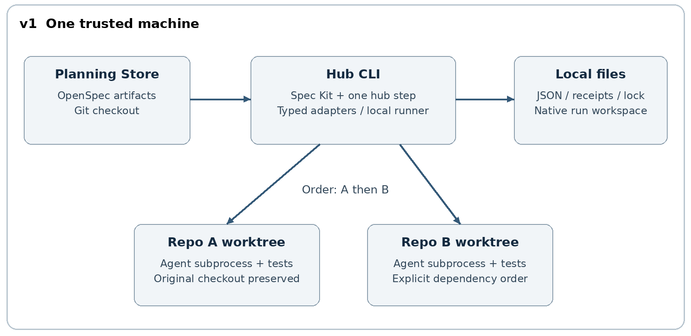
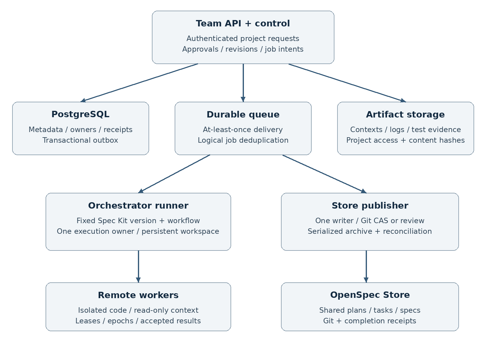

# Central Store Coordinator design

Repository handoff edition, 19 October 2026. Based on the complete revision 2 design. Read `DECISIONS.md` for the latest scope decisions; Specstride is excluded.

Document revision 2    19 October 2026

Build an independently usable local CLI as v1, then extend the same core contracts into a team service as v2. The local release coordinates OpenSpec planning, two approval checkpoints, coding agents, and tests across explicitly selected Git repositories. The team release adds a central API, authenticated roles, durable jobs, remote workers, shared evidence, and trusted approval.

Start implementation with the required v1 tasks only. v1 has no dependency on any v2 service and requires no database, message broker, Web console, or Kubernetes setup. Preserve a few stable data contracts and module boundaries now; implement server behavior only when the separate v2 phase begins.

Reading order: section 1 defines scope; section 2 guides local implementation; section 3 defines the team service; section 4 covers shared contracts and migration; sections 5 and 6 define delivery gates and runbooks. The companion workbook contains task dependencies, estimates, acceptance cases, migration checks, and editable progress fields. Document revision 2 is separate from product versions v1 and v2.

## 1 Scope and architecture

### 1.1 Explicit version boundaries

| Dimension | v1: lightweight local release | v2: team release |
| --- | --- | --- |
| Deliverable | One CLI package and central Git configuration | Server API, execution components, and remote CLI |
| Execution location | One trusted personal machine; optional single CI runner | Shared service and multiple controlled runners |
| Scheduling | Explicit repo_order, sequential by default; optional local parallelism | Durable jobs, explicit task DAG, team/project quotas |
| State | Local JSON, operation receipts, and file locks | PostgreSQL metadata plus an exclusive persistent workspace for each native run |
| Approval identity | Local confirmation; auth_level=self_asserted | Authenticated identity, project roles, and auditable decisions |
| Store writes | One CLI writer per local checkout | Controlled publisher, Git CAS/PR, serialized archive |
| Recovery | Local resume and explicit recovery | Duplicate delivery handling, worker leases, fencing, owner takeover |
| Evidence | Files, commits, test logs, and digests | Shared artifacts, access control, and retention |
| Collaboration | Share plans through Git; assign one owner; resolve conflicts manually | Multiple users submit, review, execute, and observe project work |
| Interface | CLI and readable reports | Remote CLI first; Web interface optional |

Sharing v1 configuration through Git does not provide coordinated team execution. Separate clones have no global task lock, central authorization, or shared queue. Assign one active owner to a change. Move to v2 when coordination is needed. In both versions, business repositories receive normal code and test changes; existing repository instructions such as AGENTS.md continue to apply.

### 1.2 Responsibilities and invariants

OpenSpec Store is the source of truth for specifications and change plans. Spec Kit controls workflow execution. Hub is the proposed CLI, thin adapters, and business data contracts. Hub does not run the default speckit.specify/plan/tasks flow to generate a competing specification set. Complete planning artifacts do not prove that implementation is complete. Task acceptance needs real code and test evidence; archive needs an explicit completion decision.

Use stable store_uid, change_uid, repo_id, and task_id values. Each business execution has its own execution_id. A Spec Kit run_id identifies one native orchestration run; an interrupted execution may later reference another native run. Absolute repository paths belong to machine configuration and never to the portable Store manifest.

### 1.3 Upstream interface boundaries

The official main-branch documentation checked on 19 October 2026 describes custom steps, gates, loops, fan-out/fan-in, and resume. Its persistent execution tree records branches, iterations, and items, preserving completed work during normal resume. A native run still marked running cannot be resumed directly. L01 must verify these behaviors against the actual selected release and record tool and step implementation digests. [R1]

Use OpenSpec Store as a separate planning repository and pass --store explicitly in production calls. Git synchronization remains an operator action in v1 and a publisher responsibility in v2. Worksets control working-directory visibility; they do not replace task routing or authorization. Record planning status separately from implementation evidence. Archive applies specification deltas and moves the change into history. [R2][R3]

All hub commands, type: hub actions, hub/v1 fields, and team API routes in this document are interfaces to implement. Examples define the intended contract. L01 confirms the exact SDK/CLI integration at pinned versions; documentation on main alone is not a compatibility guarantee for a released package.

## 2 v1: local implementation design



### 2.1 Installation and directory layout

Install one Python package that provides the hub CLI and its Spec Kit step bridge. External tools are Git, OpenSpec, Spec Kit, and one coding-agent CLI actually used by the implementer. Support that one agent profile first. Initialize Spec Kit and install type: hub once in the central control repository; do not initialize the tools inside every business repository.

Use two Git repositories: engineering-control holds the Hub package, workflows, rules, schemas, and profiles; engineering-plans holds OpenSpec specifications and changes. They can live in adjacent local directories linked by local.yaml. Runtime data lives in an ignored .hub directory under the control checkout. v1 has no listening port, resident service, database, broker, or account system.

| Location | Contents | In Git? |
| --- | --- | --- |
| control/workflows and Hub package | Workflows, typed adapters, profiles, schemas | Yes |
| plans/openspec | Configuration, specifications, changes, archive | Yes |
| plans/hub/changes/<change> | Hub execution.yaml and selected final summaries | Yes |
| control/local.yaml | Store/repo paths and agent executable mapping | No |
| control/.hub/runs/<execution_id> | Snapshots, state, approvals, receipts, logs, worktrees | No |
| control/.specify/workflows/runs | Native Spec Kit private execution state | No |

Keep Hub extensions under hub/ in the planning repository. Do not add unsupported fields to upstream .openspec.yaml. A stable change_uid maintains the association when OpenSpec moves a change during archive. Use verified single-level capability IDs such as api-rate-limit; do not assume nested specification namespaces are supported.

### 2.2 Minimum package modules

| Module | Responsibility | v1 implementation |
| --- | --- | --- |
| cli | doctor, plan, run, approve, resume, recover, archive | Arguments, reports, local interaction |
| models | Manifest, snapshot, result, approval, receipt | Validation, stable IDs, digests, serialization |
| openspec | Explicit-Store CLI calls and response mapping | argv calls; preserve raw response references |
| local_runtime | File state, exclusion, worktrees, processes | Atomic JSON; one active execution; synchronous waits |
| agent and tests | Context, agent invocation, independent tests | One agent profile; explicit test argv |
| speckit_bridge | One type: hub step package | Delegate actions to package functions and return one envelope |

These are modules within one package. Retain only three narrow ports: RunStore, Executor, and ArtifactStore. v1 implements FileRunStore, LocalExecutor, and LocalArtifacts. Add durable team implementations in v2. Do not build a provider plugin system, general scheduler, or empty microservices for future capabilities.

### 2.3 Configuration and task routing

The planner explicitly identifies affected repositories, tasks per repository, and repo_order. v1 does not infer affected repositories automatically. Each task_id maps to exactly one tasks.md item, for example: - [ ] 1.1 [T001] Add quota enforcement. L01 verifies that the selected upstream parser preserves this convention. A repository invocation handles all of its v1 tasks together.

v1 permits one-way cross-repository dependencies. A repo depends_on entry must point to an earlier repository in repo_order. Within a repository, task instructions define any local ordering. Split a change that needs cross-repository backtracking or multiple waves, or defer that scenario to the explicit v2 DAG. Downstream work consumes an accepted upstream commit and contract, rather than a mutable branch name.

```yaml
api_version: hub/v1
store_uid: 67f80512-00d1-4b0f-b5cd-3a1aad009002
change_id: add-global-rate-limit
change_uid: b7c9aeb5-0cd5-4ea5-a66e-0f3414b9a244
repo_order: [api-server, operator]
repos:
  - repo_id: api-server
    base_ref: main
    task_ids: [T001]
    depends_on: []
    allowed_paths: [src/ratelimit/, tests/]
    test_profile: api-unit
  - repo_id: operator
    base_ref: main
    task_ids: [T002]
    depends_on: [api-server]
    allowed_paths: [controllers/, tests/]
    test_profile: operator-unit
acceptance:
  - id: AC01
    requirement: Requests over quota are rejected.
    verifies: [T001, T002]
integration_profile: quota-e2e
completion_policy: merged_commits
budget:
  repo_max_attempts: 3
  integration_max_repairs: 2
  total_minutes: 120
```

This manifest belongs to Hub; it is not an OpenSpec native schema. tasks.md owns task wording and checkbox state. The manifest owns routing and does not duplicate completion checkboxes. Reject duplicate/missing/unmapped task IDs, unknown repositories/profiles, invalid dependency order, unsafe paths, and missing acceptance coverage. v2 reads the same fields and may add optional task_edges for finer dependencies.

```yaml
# local.yaml: machine-only, excluded from Git
store:
  id: engineering
  path: /work/plans/engineering
repos:
  api-server:
    path: /work/src/api-server
    remote_identity: github:example-org/api-server
  operator:
    path: /work/src/operator
    remote_identity: github:example-org/operator
agent_profile: primary-coding-agent
max_workers: 1
```

Test profiles use argv arrays, for example ["go", "test", "./controllers/..."]. Integration profiles define a reproducible combined test and the required repository/artifact mapping. Commands come from the trusted control repository. Agent output never becomes executable shell text. Resolve configured paths from an explicit base, then check realpath, Git top-level, and remote identity before running.

### 2.4 Commands and user flow

```bash
hub doctor
hub plan add-global-rate-limit --store engineering --request request.txt
hub run add-global-rate-limit --store engineering
# Inspect the review pack, approve its digest, then continue.
hub approve <execution-id> --kind plan
hub resume <execution-id>
hub status <execution-id>
hub approve <execution-id> --kind implementation
hub resume <execution-id>
# After the selected completion policy is satisfied:
hub archive <execution-id>
```

plan creates the change, follows upstream status/instructions to generate missing planning artifacts, validates them, and stops. A user may also prepare the plan manually or with an existing OpenSpec agent and start with run. run freezes the manifest/context, creates the execution, and starts the Spec Kit workflow. The first gate pauses for plan review. approve displays the subject digest and records local confirmation; resume checks it before supplying a native gate verdict.

After implementation and trusted verification, Hub builds a code review pack. A second approval allows the workflow to finish at ready_for_review. This means the implementation evidence was reviewed; code merging, specification archive, and deployment remain separate actions. archive is an explicit command. Rejection, failure, or exhausted budget preserves worktrees and reports for human takeover.

### 2.5 Reuse Spec Kit control flow

One type: hub package implements a small set of actions: prepare, run-repo, verify-round, assert-green, and record-ready. Keep native approval gates outside fan-out. Default max_concurrency to 1 and aggregate repository results through fan-in. A bounded loop runs the initial integration test and at most two repair rounds. An ordinary failed test returns a completed step with data.passed=false; launch failures, protocol errors, and exhausted budgets return failed.

The following proposed workflow begins from a prepared plan. prepare returns frozen context and ordered repositories. run-repo synchronously waits for the local agent and independent tests. verify-round only tests on its first round, then performs targeted repairs before retesting. Persist rounds and budgets in Hub state so resume cannot reset them.

```yaml
schema_version: "1.0"
workflow:
  id: hub-local-feature
  name: Local OpenSpec Feature
  version: "1.0.0"
inputs:
  execution: {type: string, required: true}
  plan_verdict: {type: string, default: ""}
  implementation_verdict: {type: string, default: ""}
steps:
  - id: prepare
    type: hub
    action: prepare
    execution: "{{ inputs.execution }}"
  - id: plan-review
    type: gate
    message: "Review the plan summary."
    options: [approve, reject]
    on_reject: abort
    verdict_input: plan_verdict
  - id: implement
    type: fan-out
    items: "{{ steps.prepare.output.data.repos }}"
    max_concurrency: 1
    step:
      id: repo
      type: hub
      action: run-repo
      execution: "{{ inputs.execution }}"
      repo: "{{ item }}"
  - id: collect
    type: fan-in
    wait_for: [implement]
    output: {}
  - id: integration
    type: do-while
    condition: "{{ steps.verify-round.output.data.needs_repair }}"
    max_iterations: 3
    steps:
      - id: verify-round
        type: hub
        action: verify-round
        execution: "{{ inputs.execution }}"
  - id: require-green
    type: hub
    action: assert-green
    execution: "{{ inputs.execution }}"
  - id: implementation-review
    type: gate
    message: "Review commits and verification evidence."
    options: [approve, reject]
    on_reject: abort
    verdict_input: implementation_verdict
  - id: ready
    type: hub
    action: record-ready
    execution: "{{ inputs.execution }}"
```

L01 tests loop alias visibility, fan-out item order, outputs, and resume semantics at the chosen release. If that release cannot express this loop reliably, replace only the convergence loop with a bounded function in the same package; retain Spec Kit lifecycle and gates. Do not mutate private engine context or add a second general workflow engine. Freeze external paths, step code, and model profiles as well as workflow YAML: the native YAML snapshot does not pin all external resources. [R1]

### 2.6 Worktrees, context, and result acceptance

Create a separate Git worktree for each repository under .hub/runs/<execution>/worktrees. Resolve base_ref to a commit OID when freezing. Do not copy uncommitted changes from the original checkout or overwrite them. Pass the agent only its tasks, approved plan, organization rules, existing repository instructions, dependency results, and test feedback. Set cwd explicitly. No /opsx installation is required in business repositories.

The agent writes result.json. The CLI independently checks execution/repo/task IDs, context digest, head commit, Git ancestry, changed paths, and test receipts. Tests run through the CLI or a trusted CI runner. Agent prose claiming success is insufficient. Once evidence is accepted, one Hub writer updates the matching tasks.md checkboxes. Cross-repository integration tasks are accepted only after the final combined matrix passes.

v1 assumes a trusted local operator and agent. A worktree keeps ordinary edits separate but does not sandbox a malicious process running as the same OS user. Local approval provides confirmation and drift detection, not enterprise identity or tamper-resistant audit. Enforced isolation requires actual OS/container controls or the team worker boundary; manifest path declarations alone are not permissions.

### 2.7 Digests, approvals, and file state

| Local data | Purpose | Update rule |
| --- | --- | --- |
| snapshot.json | Planning/rules/specification bytes, repo base OIDs, tool/profile versions | Immutable; changed inputs create a new execution |
| state.json | Business phase, native run IDs, rounds, budgets, current result refs | Single writer; temporary file plus atomic replacement |
| approvals/*.json | Local plan/implementation/archive confirmation | Bind subject_digest; auth_level=self_asserted |
| operations/*.json | Intent, before/after evidence, and receipt for side effects | Stable operation key; reconcile uncertain outcomes |
| results and artifacts | Repo commits, tests, and integration matrix | Digest references; verify files/Git objects before reuse |

planning_digest covers proposal, design, delta specifications, task text/dependencies, manifest routing, and acceptance criteria. Exclude checkbox markers from its canonical input. context_digest also covers organization rules, referenced specifications, and repository constraints. verification_digest covers the actual commit/artifact matrix and tests. A relevant content change invalidates its approval. Digests prevent mistakes and drift; they are not a defense against a hostile local writer.

Allow one active execution per control/Store checkout. Every mutating CLI command acquires an OS file lock. The process may exit while awaiting approval, but the active-owner record remains; another execution cannot write the checkout. Resume checks ownership and digests again. Separate clones have no shared lock, so Git conflicts require manual resolution. A state revision detects accidental overwrite without implementing distributed leases.

### 2.8 Normal resume and abnormal recovery

For a native gate pause or retryable failure, hub resume uses the upstream resume API. The currently documented contract allows paused/failed runs and retains completed occurrences. Revalidate frozen resources and reusable external results. A persistent execution tree does not make an external effect exactly once when a crash occurs before the corresponding native or Hub receipt. [R1]

After an abrupt exit, inspect process groups and process creation identity before assuming the agent/tests stopped. If native state remains running, hub recover neither edits its private state.json nor starts duplicate work. Reconcile first, mark the Hub execution interrupted, then create a new native run associated with the same execution_id. The custom step reuses verified approvals and repository results through stable operation keys. Retain the old native run for diagnosis.

Record only the small set of actual local side effects. An operation key contains execution, action, repo/task scope, attempt, and input_digest. Write intent before starting a recoverable repository attempt, accepting tasks, or archiving. Reconcile uncertain results against Git, result files, and archive state. When an agent attempt cannot be proven complete, preserve its worktree for a human retry decision. Do not promise exact continuation of an arbitrary model conversation.

### 2.9 Repair budgets and explicit archive

Default to three attempts per repository: initial implementation plus at most two repairs. Integration allows an initial test and two repair rounds, so the native loop runs at most three times. Use a configurable 120-minute overall limit as a starting point. Enter blocked with reason needs_human when a failure digest repeats without progress or a budget is exhausted. Persist counters across resume/recover. assert-green always reads the latest actual verification evidence.

The default completion_policy is merged_commits. The user merges through the existing code-review process and explicitly refreshes local target refs. Before archive, verify that each accepted implementation commit is contained in its final target history and validate the final combined code matrix. Squash, rebase, or conflict resolution may require a new accepted commit mapping, new tests, and renewed confirmation. v1 does not infer semantic equivalence. A partial merge remains partial_merge and blocks archive.

A personal project may explicitly select validated_commits in the manifest and confirm it separately at archive. Under that policy, specifications refer to reviewed and tested commits without claiming those commits reached main. v1 does not merge, push, or deploy automatically. Git synchronization is explicit; a running execution does not pull new planning content.

Before archive, verify task evidence, completion policy, final confirmation, a clean Store, and relevant baseline specification digests. Save local before copies of affected files and record intent. Invoke OpenSpec archive with explicit --store and --yes through argv; do not skip validation or specification updates by default. Check active/archive paths and resulting specifications afterward, then write completion. Reconcile unknown outcomes. Preserve mixed states for manual repair rather than applying deltas again. [R3]

### 2.10 v1 release gate

- A fresh installation of one Hub package and the agreed external tools completes planning, sequential work in two repositories, and integration verification.
- Both local approvals, bounded repair, normal resume, abnormal takeover, and explicit archive work without any team service.
- Business repositories need no new tool scaffolding. Original checkouts stay intact. Approval and tests bind to actual content.
- All V1-A01 through V1-A14 cases pass. Keep replays for a normal run, a deliberate failure/repair, and abnormal recovery.
- Local parallelism and Jenkins remain optional enhancements and do not block the standalone release.

## 3 v2: team service design



### 3.1 Entry conditions and deployment units

Begin v2 after v1 is stable and real users need central submission, approval, queuing, execution on different runners, or shared evidence. The first team release serves multiple projects within one organization. Public SaaS, multiregion availability, and billing are outside this release. Add a Web interface after the remote CLI works if it is useful.

| Unit | Responsibility | Persistent state |
| --- | --- | --- |
| API and control process | Authentication, authorization, typed requests, approvals, queries | Project/execution metadata in PostgreSQL |
| Orchestrator runner | Run pinned Spec Kit and the existing workflow | Exclusive native workspace per execution |
| Durable queue | Deliver orchestrator/worker jobs reliably | Outbox and broker messages |
| Remote workers | Controlled clone; agent/tests; result upload | Separate worktrees; short-lived credentials |
| Store publisher | Accept task updates, summaries, archive, Git publication | Store checkout; writer epoch; receipts |
| Artifact storage | Contexts, logs, results, review packs | Object bytes; hashes; access/retention metadata |

The first deployment may place API, publisher, and orchestrator management on one host while keeping responsibilities and permissions separate. Use PostgreSQL, one durable broker, and one object store. Choose an existing organizational broker where suitable; required semantics are at-least-once delivery, explicit acknowledgement, and observable retries. Application uniqueness constraints still provide business idempotency.

### 3.2 Shared core and backend selection

Keep the user intent of plan/run/status/approve/resume/archive. --backend local calls the local core; --backend team calls the API. Reuse hub/v1 manifests, snapshots, tasks, results, and approval shapes. The server independently validates schema, identity, project permission, scope/digest, and budgets, even when client preflight succeeded.

Replacing JSON with database tables alone does not create a team service. v2 adds trusted identity, durable jobs, orchestrator ownership, remote paths, a single Store publisher, and shared evidence. Do not translate Spec Kit private state into PostgreSQL. Store its run ID, workspace, owner, image/version, and digest indexes in PostgreSQL while preserving native state in its own workspace.

### 3.3 API and authorization

| Operation | Request/result | Consistency |
| --- | --- | --- |
| POST /api/v1/projects/{p}/executions | change_uid, planning_digest, controlled profile; returns execution_id | Idempotency-Key; same key/different payload gives 409 |
| GET .../executions/{e} | Phase, jobs, review subjects, evidence refs | Project authorization; hide private SDK state |
| POST .../{e}/approvals | kind, decision, subject_digest, scope | Actor from token; If-Match; role policy |
| POST .../{e}/resume | Expected revision and allowed parameters | One owner; do not redispatch accepted work |
| POST .../{e}/cancel | Reason and expected revision | Propagate cancellation; preserve evidence |
| POST .../{e}/archive | Final approval and completion digest | Publisher rechecks Store and code digests |
| GET .../{e}/artifacts/{a} | Authorized ref; returns bytes or temporary access | Project/hash checks; no arbitrary local path |

Product v2 uses transport API /api/v1; business data remains hub/v1. Return 401 for unauthenticated calls, 403 for denied access, 409 for revision/digest conflicts, and 422 for invalid input. Quota decisions return explicit queued or rate-limited responses. Include request_id, execution_id, and a stable error code. Do not expose secrets, raw internal command lines, or private state trees as API output.

Minimum roles are viewer, operator, reviewer, and project-admin. Viewers read project data. Operators submit and resume permitted work. Reviewers approve within an assigned scope. Administrators manage repository/profile bindings and membership. A project policy decides whether an initiator may self-review, enforced on every relevant server action. Request bodies cannot choose a trusted actor or promote local self_asserted approval into authorization.

### 3.4 Database, queue, and native state

| Records | Key/constraint | Purpose |
| --- | --- | --- |
| projects/repos/store_bindings | Unique project plus stable identity | Project, repository, and Store ownership |
| executions | execution_id; deduplicated project/change/input key | Immutable snapshot; phase; revision; policy |
| native_runs/owners | Execution plus native run; one active owner | Workspace, image, owner_epoch, recovery location |
| jobs/attempts | Unique logical job key plus attempt | Queue/running/terminal state; lease_epoch; results |
| approvals/artifacts | Subject digest/scope; artifact digest | Trusted approval; evidence; access controls |
| operation_intents/outbox/events | Unique project-scoped idempotency key | Reconciliation, reliable delivery, audit |

Write execution/job records and outbox entries in one transaction. A dispatcher publishes pending messages; a consumer looks up the logical job key and attaches to existing work on duplicate delivery. Commit accepted-result receipts and state updates consistently. Broker acknowledgement does not prove business completion, and worker success does not mean a task was accepted. Cancellation, timeout, and retry each produce explicit attempt or terminal state.

Each execution has one orchestrator owner at a time, holding an epoch. It uses an exclusive persistent .specify workspace and pinned tool/step image. A gate pause may exit the process; resume remounts the same workspace. An orphan running run follows the native contract plus Hub reconciliation. Never resume it concurrently on two machines. Confirm the old process stopped before takeover, then increment the epoch and reject every stale-owner publication request.

Do not let orchestrators share a writable native run directory. Do not build team state on network-shared SQLite or assume an upstream remote state backend exists. Backups need the database, native workspaces, frozen context bytes, and artifact index. Database backup alone cannot restore an unfinished native workflow.

### 3.5 Remote workers and scheduling

RemoteExecutor launches a job with controlled remote identity, commit OID, and profile. The runner assigns clone/worktree paths; client /Users/... paths and Jenkins WORKSPACE do not enter the remote contract. A worker receives only writable job code and read-only context. It cannot write the Store or controller database. Issue short-lived, repository/project-scoped credentials.

Workers heartbeat regularly. An expired lease first becomes suspect. Query the execution system and confirm termination or enforced loss of access before reassignment. A new attempt has a higher lease_epoch. Result callbacks include job, attempt, epoch, context, base/head OIDs, and artifact hashes. Accept results only from the current epoch after validation. Preserve late results for audit without letting them overwrite accepted current results.

Read explicit task_edges and repo_order to compute ready batches. Do not infer dependencies from natural language. Configure global/project/repo limits separately and allow one writer per worktree. Begin with FIFO plus project fairness; defer preemption and elaborate priorities. Waiting for capacity never discards already accepted work.

### 3.6 Store publication and cross-repo completion

Only the publisher writes the team Store. Workers upload results; the control plane validates them and queues task acceptance and summary updates. Serialize all writes and archive operations per Store. Check writer_epoch and expected Git base. When changes affect the same capability, rerun merge preflight; conflicts require review. Never force push over another writer.

Use merged_commits by default and the existing authorized code-review platform for merges. Completion records each repository final accepted/merge OID and CI receipts. Changed code, artifacts, or policy invalidate verification approval. After squash/rebase, verify the actual final matrix. Cross-repository merges are not atomic: partial_merge blocks archive until the owner completes repair or chooses a separate revert process.

Archive retains v1 intent, before/after evidence, postconditions, and receipt, adding DB exclusion and the publisher epoch. If archive or push succeeded before registration, inspect actual archive/specification state and remote Git commit before recording completion. Block uncertainty rather than replaying archive. Roll back specifications through a separate reviewed change without overwriting subsequent publications.

### 3.7 Evidence, operations, and release

Index artifacts by permanent ID, project, SHA-256, media type, size, provenance, and retention period. Temporary URLs are access mechanisms, not evidence primary keys. Reviewers must be able to read contexts, patches, test matrices, and final results. Apply redaction, retention, and deletion centrally. Audit actors come from authentication; events reference execution, job, and operation key.

Before release, run normal, repair, pause, and owner-rebuild paths with two people on different runners. Inject duplicate deliveries, stale results, access violations, and uncertain archive outcomes. Observe budgets, queue delay, lost work, planning drift, unresolved archive, and unreadable evidence. Measure RPO/RTO during the pilot before setting recovery commitments. Pass all V2-A01 through V2-A12 and MIG-A01 through MIG-A05 cases.

## 4 Shared contracts and migration

### 4.1 Stable objects and state ownership

| Object | Required content | Version distinction |
| --- | --- | --- |
| ChangeManifest | api_version, Store/change IDs, repo/task IDs, dependencies, acceptance, policy | v2 may add optional task_edges without changing existing semantics |
| ExecutionSnapshot | Execution ID, manifest/context digests, repo base OIDs, tool/profile locks | Portable snapshot excludes machine paths |
| RepoResult | Execution/repo/task IDs, base/head, changed paths, tests, context digest | v2 adds job/attempt/epoch and a trusted producer |
| Approval | Kind, decision, subject digest, scope, actor, auth_level, timestamp | v1 self_asserted; v2 server-written authenticated actor |
| OperationReceipt | Operation key, input digest, intent/status, before/after, evidence | v1 files; v2 durable idempotency records |
| Completion | Accepted code matrix, tests, approvals, policy, archive receipt | Separate historical records from executable state |

OpenSpec owns planning artifacts and checkboxes. Spec Kit owns native step position. Hub owns external results and operation receipts; v2 adds jobs and owners. Do not reproduce a complete business state machine in tasks.md. Public Hub phases are planned, awaiting_plan_review, implementing, verifying, awaiting_implementation_review, ready_for_review, and archived, with blocked/interrupted/cancelled outcomes. Report native-run and job status separately.

```json
{
  "api_version": "hub/v1",
  "action": "run-repo",
  "ok": true,
  "store_uid": "67f80512-00d1-4b0f-b5cd-3a1aad009002",
  "change_uid": "b7c9aeb5-0cd5-4ea5-a66e-0f3414b9a244",
  "execution_id": "32fc760b-0c61-4d10-a4d1-79989eadad67",
  "data": {
    "repo_id": "api-server",
    "task_ids": ["T001"],
    "passed": true,
    "result_ref": "artifact:repo-result-1"
  },
  "evidence": ["artifact:unit-tests-1"],
  "warnings": []
}
```

The shared envelope uses api_version, action, ok, business IDs, data, evidence, and warnings. Failures also include error={code,message,retryable,details}. Save the envelope as step output; expressions read output.data consistently. Reject unsupported schema major versions and unknown critical fields. New optional fields must preserve old semantics. Example UUIDs are illustrative; commits and SHA-256 values must come from real execution.

### 4.2 Preserve only three narrow ports

```python
class RunStore(Protocol):
    def load(self, execution_id: str) -> ExecutionState: ...
    def save(self, state: ExecutionState, expected_revision: int) -> None: ...
    def record_operation(self, receipt: OperationReceipt) -> None: ...

class Executor(Protocol):
    def run(self, request: RepoRunRequest) -> RepoResult: ...

class ArtifactStore(Protocol):
    def put(self, content: bytes, media_type: str) -> ArtifactRef: ...
    def get(self, ref: ArtifactRef) -> bytes: ...
```

These are package-level type contracts, not a requirement for registration, a dependency injection framework, or network implementations in v1. Local Executor.run starts a process and waits synchronously. In v2, an adapter may submit a remote job and wait for its outcome through the same action. Queue, cancellation, and lease coordination are additional v2 internals. Each backend resolves its own paths; core logic uses stable repo identity and ArtifactRef.

### 4.3 Portable data and capability limits

| Content | Migration approach | Constraint |
| --- | --- | --- |
| Workflows, rules, schemas, specifications | Retain Git and verified versions; register to project | Server reviews trusted source and applicable scope |
| Terminal executions/results/completion | Portable bundle imported as read-only history | Create no jobs; repeat import is idempotent |
| Local approvals | Preserve self_asserted provenance | Grant no team execution/archive permission |
| Machine local.yaml | Replace with platform repo catalog and profiles | Do not upload paths/secrets as ordinary artifacts |
| Running/paused native runs | Finish or cancel locally | Do not resume a copied private tree on the platform |
| Further work on an open change | New team execution; fresh freeze and approval | Reuse accepted commits only through explicit validation |
| Archived changes | Import historical identity and receipt | Never replay archive or apply deltas twice |

### 4.4 Migration sequence and rollback

- Finish v1 required acceptance and freeze tool, schema, and artifact formats. Keep a replayable fixture bundle.
- Start v2 S0. Configure project, roles, repo/Store identities, and controlled profiles. Prove the remote CLI.
- Export selected terminal local executions. Include an inventory, relative paths, hashes, versions, and provenance; exclude secrets, absolute paths, and live process state.
- Preflight schema, UID/remote mapping, paths, size limits, and hashes. Deduplicate by origin execution ID plus bundle digest. Import history without dispatching jobs.
- Select a new unexecuted change. Create a team execution, freeze inputs on the server, obtain authenticated approval, and run on another runner.
- For an open change, stop its local owner before creating team work. One backend advances the change at a time.
- For rollback, stop new team dispatch/archive and reconcile jobs, owners, and Store state before continuing new local work. Do not automatically undo business merges or specification archive.

Native private run state is not a cross-backend contract. A diagnostic copy may be retained locally but is not imported as executable state. Export only portable data; sanitize or omit logs containing secrets or machine paths. No export promises lossless continuation across versions or platforms. Team identity, authorization, remote visibility, and durable delivery are new v2 capabilities, not properties obtained by converting a JSON file.

## 5 Implementation plan

### 5.1 Complete v1 independently

Required v1 tasks L01-L15 total 14 person-days, planned as about three weeks for one implementer. Optional L16-L17 add 1.5 person-days. Treat estimates as approximately +/-30%, depending on agent integration and pinned-version compatibility. Windows are relative working weeks, not committed calendar dates.

| Stage | Deliverable | Exit gate |
| --- | --- | --- |
| L0 Compatibility | Pinned versions; CLI/SDK fixtures; normal and abnormal recovery experiment | V1-A01; production integration proven |
| L1 Local foundation | Single CLI, manifest, repo mapping, file state, adapter | Configuration/exclusion correct; no server dependency |
| L2 End-to-end loop | Planning, two approvals, sequential repo work, trusted test/repair | Two fixture repos reach ready_for_review |
| L3 Release reliability | Resume/recover, explicit archive, installation, runbook | All 14 required v1 cases pass; usable release |
| L4 Optional | Local parallelism; one Jenkins runner | Separate acceptance; does not block release |

Use L01 to fix interfaces first, then implement L02-L05 foundation, L06-L12 end-to-end behavior, and L13-L15 reliability/release. The workbook gives dependencies, outputs, estimates, owners, acceptance IDs, and definitions of done for direct issue creation. v1 can remain in use indefinitely without starting v2.

### 5.2 Start v2 as a separate phase

Required v2 tasks S01-S19 total 34.5 person-days. Plan roughly six to eight weeks after the v1 gate and an explicit start decision, with two engineers plus scheduled QA/owner participation. Dependencies and pilot work make calendar time longer than effort divided by headcount. Optional Web task S20 adds a preliminary three person-days, subject to its actual UI scope.

| Stage | Added capability | Exit gate |
| --- | --- | --- |
| S0 Team entry | Real collaboration case, pilot, roles, scope | Who submits/approves and where work runs are defined |
| S1 Control plane | Authenticated API, DB/outbox, orchestrator ownership | Idempotency, concurrent update, and durable-state cases pass |
| S2 Team execution | Workers, leases/fences, quotas, trusted approvals, publisher, artifacts | Multiple users/runners work with enforced authorization |
| S3 Integration | Remote CLI, terminal-history import, audit/budgets | All five migration cases pass |
| S4 Team release | Failure matrix, two-user pilot, deployment/restore/rollback | All required team and migration cases pass |
| S5 Optional UI | Web execution and approval pages | Same API and permissions; no copied core rules |

### 5.3 Stop conditions and scope control

If v1 acceptance is incomplete, fix its local loop before building team components. Central accounts, shared queues, scheduling across machines, enforced project permissions, and central dashboards belong to v2. If a required upstream interface is unavailable at the selected release, adapt the thin bridge or bounded convergence function and record compatibility; avoid forking the engine or substituting a platform for the local proof.

The workbook checks required v1 tasks, required v1 acceptance, and a manual v2 start decision separately. A completed task is not a passed acceptance case. Completing v1 does not start or deploy a platform automatically. Team release adds authorization, queue, runner, migration, and operational gates.

## 6 Acceptance and runbooks

### 6.1 Layered release evidence

| Cases | Coverage | Evidence to retain |
| --- | --- | --- |
| V1-A01 to A05 | Upstream contract, standalone use, routing, planning, approval | Versions/JSON, Git diff, findings, digests |
| V1-A06 to A10 | Worktrees, tests, locks, ordered repos, recovery | Base/head, test receipts, state revisions, native-run mapping |
| V1-A11 to A14 | Completion/archive, portability, installation, takeover | Policy, before/after evidence, backup, replays |
| V2-A01 to A06 | Identity, API, queue, orchestrator, worker, fencing | Auth events, DB keys, delivery/owner/epoch timelines |
| V2-A07 to A12 | Quotas, trusted approval, Store, evidence, pilot, operations | Scheduler/archive/access records, pilot, restore drill |
| MIG-A01 to A05 | Bundles, idempotent import, provenance, active/archived work | Import receipts, identity mapping, rejection reasons, rollback |

The workbook contains executable acceptance instructions and pass criteria. Run failure-injection scenarios on disposable Stores and fixture repositories before selecting a low-risk real change. Static validation of these documents and examples does not replace pinned-tool, agent, or server acceptance during implementation.

### 6.2 v1 operation cards

| Situation | Action | Preserve or block |
| --- | --- | --- |
| New work | doctor, plan, run, inspect review pack, approve, resume | Pin versions, base commits, and digests |
| Plan/rule drift | Stop; create a new snapshot/execution; reapprove | Validate any proposed result reuse explicitly |
| Normal pause/failure | Check native state, resources, and budget; resume | Do not reset repair counters |
| Abrupt exit | Confirm children stopped; reconcile/recover; use a new native run if needed | Keep old run, worktrees, receipts |
| Task/test failure | Read exact logs; repair within budget or hand over | Failed verification cannot become ready/archive |
| Partial merge | Keep partial_merge; owner chooses repair or revert | Archive waits for complete acceptance and retest |
| Uncertain archive | Lock Store; inspect intent and active/archive/spec state | Preserve backup; do not replay mixed state |
| Cleanup/backup | Remove worktrees only after terminal state and explicit review | Retain shared summaries, refs/hashes, recovery material |

### 6.3 v2 operations and rollback

For a missing owner/worker, inspect the execution system, fence old authority, and only then take over. Deduplicate queue messages by logical job key. Resolve Store conflicts through publisher preflight and review. Repair evidence access/retention before accepting unreadable results. Disable new submission and archive independently while keeping queries, evidence, and human takeover available.

Before an upgrade, replay compatibility and fault fixtures. Keep active executions on their pinned images and step versions. Restore database, native workspaces, and artifacts, then reconcile before enabling dispatch. A control-plane rollback does not automatically revert merged code, approval history, or archived specifications.

## 7 Implementation contracts and sources

### 7.1 Initial data constraints

Deliver machine-checkable manifest, snapshot, result, approval, and receipt schemas during L03. Require stable ID formats, explicit enums, nonempty required fields, rejection of unknown critical fields, and relative paths without traversal. JSON Schema validates shape. Semantic validation checks repository identity, task-text mapping, Git ancestry, digest validity, and dependency order.

```json
{
  "$schema": "https://json-schema.org/draft/2020-12/schema",
  "$id": "urn:hub:approval:v1",
  "type": "object",
  "additionalProperties": false,
  "required": ["api_version", "execution_id", "kind", "decision",
    "subject_digest", "scope", "actor", "auth_level", "timestamp"],
  "properties": {
    "api_version": {"const": "hub/v1"},
    "execution_id": {"type": "string", "format": "uuid"},
    "kind": {"enum": ["plan", "implementation", "archive"]},
    "decision": {"enum": ["approve", "reject"]},
    "subject_digest": {"type": "string", "pattern": "^[a-f0-9]{64}$"},
    "scope": {"type": "string", "minLength": 1},
    "actor": {"type": "string", "minLength": 1},
    "auth_level": {"enum": ["self_asserted", "authenticated"]},
    "timestamp": {"type": "string", "format": "date-time"}
  }
}
```

A shared approval schema represents different trust levels without equating them. A v1 writer produces only self_asserted records. Only the authenticated v2 service can issue current authenticated approval. An importer never inherits authorization from source auth_level; preserve historical provenance and require fresh approval for current work.

### 7.2 Upstream calls and step installation

```bash
openspec new change add-global-rate-limit --store engineering --json
openspec status --change add-global-rate-limit --store engineering --json
openspec instructions apply --change add-global-rate-limit --store engineering --json
openspec validate add-global-rate-limit --type change --store engineering --strict --json
# Archive only after Hub checks explicit completion approval.
openspec archive add-global-rate-limit --store engineering --yes
```

Invoke actual commands with argv arrays. Parse JSON stdout and retain stderr for diagnosis. Verify archive output flags against the selected --help; do not assume every command accepts a uniform --json option. Install one type: hub package with step.yml and __init__.py at its root. Its Python execute maps config/context to typed requests and calls core functions in the same package. [R1][R3]

```yaml
step:
  type_key: hub
  name: Local and Team Hub Bridge
  version: "1.0.0"
  author: Engineering
  description: Typed OpenSpec and execution operations
```

### 7.3 Official references and version evidence

These sources support upstream capability statements. The local/team architecture, proposed interfaces, budgets, stages, and effort estimates are design choices in this document. Save actual release identifiers, source/document digests, and fixture evidence during implementation. Main-branch documentation changes over time; historical candidate versions and outdated recovery assumptions are not support commitments.

[R1] Spec Kit workflow reference. Custom steps, gates, loops, fan-out/fan-in, execution tree, normal resume, and execution trust boundary. Accessed 19 October 2026.
https://github.com/github/spec-kit/blob/main/docs/reference/workflows.md

[R2] OpenSpec Stores beta guide. Store registration, Git synchronization, and workset boundaries. Accessed 19 October 2026.
https://github.com/Fission-AI/OpenSpec/blob/main/docs/stores-beta/user-guide.md

[R3] OpenSpec CLI reference. Status, instructions, validation, archive, and planning versus implementation completion. Accessed 19 October 2026.
https://github.com/Fission-AI/OpenSpec/blob/main/docs/cli.md
